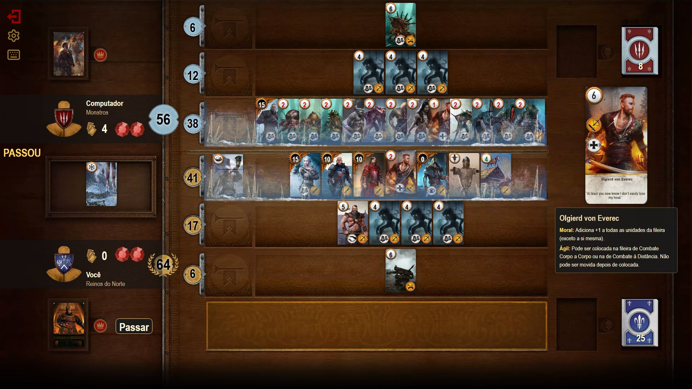
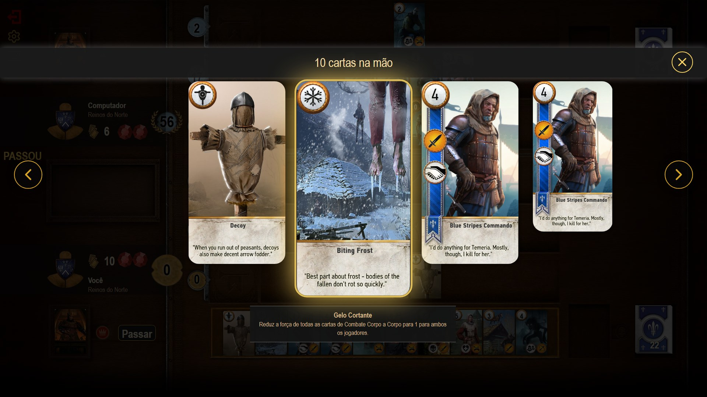
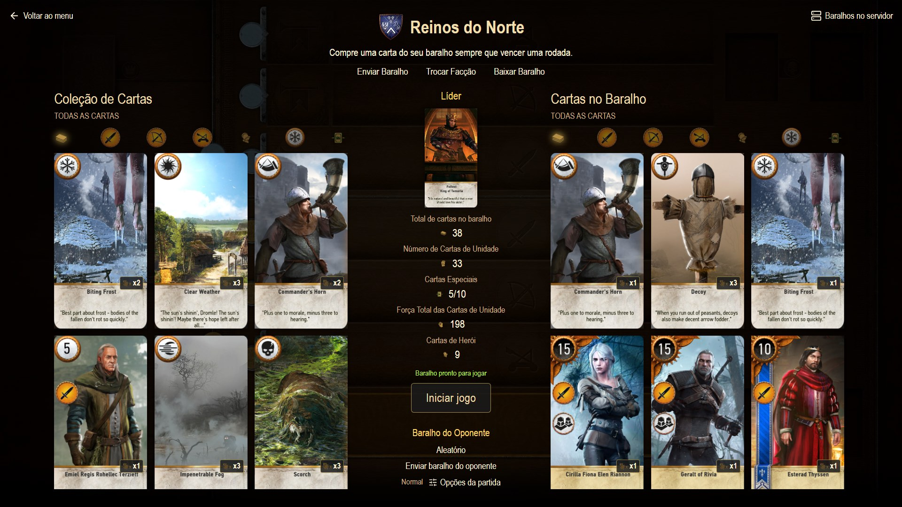
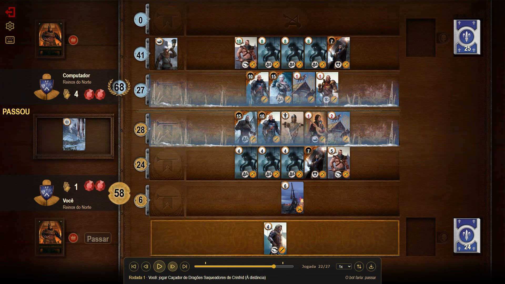

# Gwent

Remake do Gwent do The Witcher 3 em React + TypeScript: partidas contra o computador (três níveis de
dificuldade e regras extras), multiplayer com espectadores, replays e histórico.



<table>
  <tr>
    <td width="33%"></td>
    <td width="33%"></td>
    <td width="33%"></td>
  </tr>
  <tr>
    <td align="center">Detalhes das cartas</td>
    <td align="center">Montador de baralho</td>
    <td align="center">Replays</td>
  </tr>
</table>

## Créditos

Baseado em **Gwent Classic**:
[gwent-classic-multiplayer](https://github.com/Wanesia/gwent-classic-multiplayer), fork de
[gwent-classic](https://github.com/asundr/gwent-classic) por Arun Sundaram.
O código original serviu de base: as regras do jogo e o bot (nível Normal) partem da lógica dele, e
os dados das cartas, os baralhos prontos e as traduções foram convertidos dele. Sobre essa base, o
projeto foi reorganizado (TypeScript, regras separadas da interface, servidor próprio) e ganhou
recursos novos: bot Fácil e Difícil, mutadores, replays, histórico conferido pelo servidor,
multiplayer com servidor autoritativo e espectadores, controle e teclado, acessibilidade e testes
automatizados. A ideia é continuar expandindo o jogo (veja o [roadmap](docs/roadmap.md)).
Detalhes e licença em [THIRD_PARTY_NOTICES.md](THIRD_PARTY_NOTICES.md).

Artes, sons e música pertencem à **CD PROJEKT** e vêm do projeto original
(`apps/web/public/assets/`). Estão aqui só para fins acadêmicos e não comerciais. Este projeto não
tem relação com a CD PROJEKT.

## Requisitos

- Node 22+ e pnpm (`npm i -g pnpm`)
- Opcional: Docker Desktop (servidor: perfis, histórico, multiplayer)

## Começando

```bash
pnpm install
pnpm dev        # http://localhost:5173
```

Sem servidor, o jogo funciona inteiro contra o computador e salva tudo no navegador.

### Servidor (opcional)

Com o Docker aberto:

```bash
pnpm db:setup                                # .env + PostgreSQL (porta 5433) + migrações
pnpm --filter @gwent/server db:seed          # opcional: perfil "Demo" com os decks prontos
pnpm dev:all                                 # front (5173) + API (http://localhost:3000/api)
```

Adminer (ver o banco) em http://localhost:8080. `pnpm db:down` para tudo.

**Variáveis de ambiente.** O `pnpm db:setup` cria dois arquivos `.env` a partir dos `.env.example`
(nenhum `.env` vai para o git):

| Arquivo            | Variáveis                                                                                                          |
| ------------------ | ------------------------------------------------------------------------------------------------------------------ |
| `.env`             | Postgres e Adminer no Docker: `POSTGRES_USER`, `POSTGRES_PASSWORD`, `POSTGRES_DB`, `POSTGRES_PORT`, `ADMINER_PORT` |
| `apps/server/.env` | API: `DATABASE_URL` (montada com os valores do `.env` da raiz), `PORT`, `WEB_ORIGIN` (origem liberada no CORS)     |

Os valores padrão (`gwent`/`gwent`, porta 5433) servem só para desenvolvimento. Para trocar, copie
`.env.example` para `.env` e edite **antes** do primeiro `pnpm db:setup`. O Postgres só aplica
usuário e senha quando cria o volume; para trocar depois, `docker compose down -v` (apaga o banco
local), apague o `apps/server/.env` e rode `pnpm db:setup` de novo.

## Como jogar

- **Menu → Jogar contra o computador** abre o montador de baralho; **Iniciar jogo** começa.
  Em **Opções da partida** ficam a **dificuldade** — Fácil (às vezes joga uma carta qualquer), Normal
  (equilibrado: avalia cada carta antes de jogar) ou Difícil (simula as jogadas antes de decidir; ~1 s por jogada) — e os
  **mutadores**: Mãos cheias (12 cartas), Sem líderes, Inspiração (+1 numa unidade a cada jogada) e
  Clima persistente.
- **Mouse:** clique numa carta da mão e depois na fileira/alvo destacado. Clique numa carta do
  tabuleiro (ou no cemitério), clique direito em qualquer carta ou tecla **V** para ver em detalhe.
- **Teclado:** ←/→ andam pela mão, Enter seleciona/joga, ↑/↓ trocam o alvo, Esc cancela,
  **segure P** (1 s) para passar, L usa o líder, **H** mostra todos os atalhos.
- **Controle** (Xbox, PlayStation etc.): direcional move, A confirma, B cancela, **segure X** para
  passar, Y mostra detalhes, LT/RT usam o líder. Nos menus, o direcional move o foco e A clica.
- `/game?seed=123` repete a mesma partida (útil para reproduzir bugs).
- **Configurações** (menu ou engrenagem): idioma (pt-BR, en, es), notificações, sons e música.

### Com o servidor

- **Baralhos no servidor** (no montador) cria um perfil e salva/carrega baralhos; as partidas
  terminadas vão para o **Histórico** (o servidor reproduz cada uma para conferir o resultado).
- **Jogar online:** sala com código de 5 letras, entrar pelo código ou partida rápida. Para testar
  sozinho, abra duas abas. Cada jogador só recebe o que pode ver.
- **Assistir:** lista **Partidas ao vivo** no lobby ou **Assistir** com o código. O espectador não vê
  nenhuma mão; os jogadores veem quantas pessoas assistem.

### Replays

Qualquer partida pode ser assistida de novo, jogada por jogada: **Assistir replay** na tela final
(contra o computador, sem servidor) ou ▶ no **Histórico**. Tem linha do tempo com as rodadas,
velocidade, troca de lado, a sugestão do bot para cada jogada e **Exportar** (arquivo .json que se
abre em **Histórico → Abrir arquivo de replay**). Atalhos: Espaço/Enter, ←/→, Home/End.

## Scripts

| Comando                               | O que faz                                                            |
| ------------------------------------- | -------------------------------------------------------------------- |
| `pnpm dev` / `pnpm dev:all`           | front / front + servidor em modo desenvolvimento                     |
| `pnpm test` / `pnpm test:watch`       | testes unitários (Vitest)                                            |
| `pnpm e2e` / `pnpm e2e:ui`            | testes e2e (Playwright) / modo interativo                            |
| `pnpm verify`                         | formatação, lint, tipos, testes unitários e build (o mesmo que o CI) |
| `pnpm verify:all`                     | `verify` + e2e                                                       |
| `pnpm lint` / `pnpm format`           | ESLint / Prettier                                                    |
| `pnpm typecheck` / `pnpm build`       | TypeScript / build de produção                                       |
| `pnpm db:setup` / `db:up` / `db:down` | preparar / subir / parar o Postgres no Docker                        |

Como rodar e escrever testes, depurar falhas e o que o CI faz: [docs/testes.md](docs/testes.md).

## Estrutura

```
apps/web          React + Vite + Tailwind + Zustand + Motion + TanStack Query
apps/server       NestJS + Prisma 7 + PostgreSQL (Docker) + Socket.IO
packages/engine   regras do jogo e bot (TypeScript puro, determinístico)
packages/shared   schemas Zod compartilhados (baralho, API, socket)
packages/config   tsconfig base
e2e/              testes Playwright
scripts/          preparação do servidor e leitura dos .env
docs/             roadmap, testes, guia de mecânicas e decisões de arquitetura (ADRs)
```

## Documentação

- [docs/roadmap.md](docs/roadmap.md): próximas features (contas e partida ranqueada, estatísticas,
  quebra-cabeças, bot mais forte…) com o desenho de cada uma e o checklist para implementar.
- [docs/mecanicas.md](docs/mecanicas.md): como adicionar cartas, habilidades, líderes e mutadores.
- [docs/testes.md](docs/testes.md): testes unitários, e2e e CI.
- [docs/adr/](docs/adr/): decisões de arquitetura.

## Contribuindo

Commits seguem [Conventional Commits](https://www.conventionalcommits.org/) (`feat: ...`,
`fix: ...`), conferidos pelo commitlint. Antes de cada commit, ESLint e Prettier rodam nos arquivos
alterados; antes de cada push, `pnpm typecheck && pnpm test`. Código, comentários e testes em inglês.
